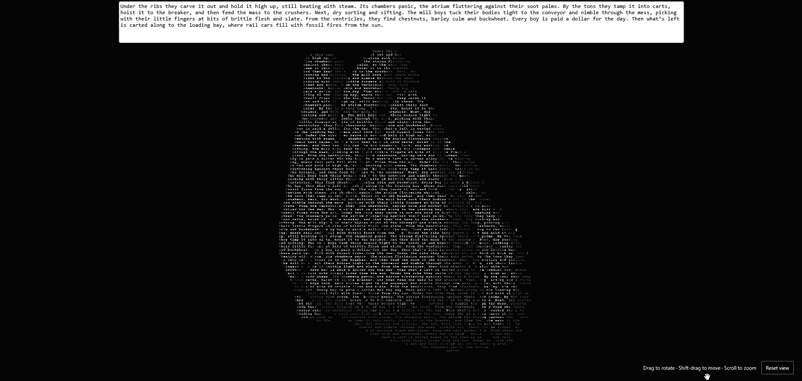

# All Fork Changes Inside ./beatingHeartShader

# __Poem Heart — 3D / WebGPU__



#### <center>[click here to view in browser](https://a88dd1b7-poem-heart-webgpu.mypage-dev.workers.dev/)</center>

An anatomical human heart rendered entirely as ordered monochrome poem characters. The bundled GLB contains 11 anatomical mesh parts and 96,724 triangles. You can orbit the actual geometry, zoom, and watch a stylized 48 BPM ventricular contraction. Each of the two contractions holds its peak for 100 ms, with smooth entry and release and 250 ms between peak centers. These durations stay fixed in real time across frame rates; slower tempos add rest between beat pairs.

Heartbeat poses update in 100 ms steps within each beat cycle to reproduce the reference PC's 10 FPS appearance on faster devices. Restarting the pose sequence each cycle prevents alternating sampling phases from merging the two contractions. The entire canvas render pipeline is also capped at 10 FPS, including rotation and panning. Rendering may be slower on devices that cannot keep up. Beat tempo uses elapsed time; dropped frames do not slow its clock. The visible heartbeat is deliberately stepped, and sampled peaks may appear on adjacent 100 ms ticks around their programmed times.

## Requirements
- Needs a WebGPU supported browser

## Notes
I made this for my poetry capstone in October of 2026. I had always been intreseted in graphics programming and was looking for a good way to combine my Major (Computer Science) with my Minor (Creative-Writing). This was made over the course of weekend after watching Acerola's [Ascii Rendering Video](https://www.youtube.com/watch?v=gg40RWiaHRY&t=293s). Hope you find it cool!

## Run

The page contains only the heart canvas and a plain text input. The poem updates as you type. Text size is fixed at **8 pixels**.

From this folder:

```sh
node server.mjs
```

Open **http://localhost:5173** in Chrome or Edge with WebGPU enabled. No package installation or remote CDN is required. If the server is already running, refresh the page.

- Drag to rotate; Shift-drag to move; scroll to zoom.
- On touch screens, drag with one finger to rotate, two fingers to move, and pinch to zoom. Use Reset view to recenter.
- With the canvas focused: arrows rotate, + / - zoom, Home resets, Space pauses the beat.
- Page Up / Page Down navigate longer poems. Short poems repeat to fill the heart.
- Text reads left to right, top to bottom. It reflows when the visible silhouette changes.

## Shader reference and pipeline

Reference: **../Shaders/AcerolaFX_ASCII.fx**. Its downsampled cells, luminance, edge information, and atlas-based glyph rendering informed this implementation. This is a native WebGPU implementation, not a direct port of ReShade's DoG/Sobel pipeline.

1. **model.js** reads the bundled uncompressed GLB, including interleaved accessors, and normalizes its coordinates. The loader is specific to this asset's static, baked transforms.
2. **mesh.wgsl** deforms the vertices for a double contraction, rotates the model, projects it with perspective, and depth-tests all anatomical surfaces into a floating-point normal/depth texture at three times the text-grid resolution in each dimension.
3. **smooth.wgsl** applies a 7×7 joint bilateral filter with a Gaussian spatial weight to normals and depth before lighting. Depth and normal differences preserve major anatomical boundaries; background stays empty.
4. **contours.wgsl** computes lighting and a separate Sobel edge classification from the softened geometry. Depth-curvature gating rejects smooth slopes; non-maximum suppression thins internal edges.
5. **contours.js** reads the silhouette; **layout.js** wraps the poem through every occupied cell, including edge cells. Edges never displace letters or change text layout.
6. **shader.wgsl** quantizes softened lighting to four broad brightness bands and adds a small brightness accent at contours. Shadowed letters retain a brightness floor. It draws the ordered poem with fixed glyph size and orientation, without inserting contour characters. Every foreground pixel comes from glyph ink.


The mesh pass is hidden. Both glyphs and background use equal RGB channels. The readback keeps text and silhouette synchronized but may limit frame rate on slower GPUs.

## Model and attribution

**assets/heart.glb** is also available through the page's Download 3D model link and can be opened in Blender or another GLB viewer. The GLB contains the static anatomical geometry; the poem shader and pulse run in this WebGPU app.

BodyParts3D, © The Database Center for Life Science, licensed under [CC BY 4.0](https://creativecommons.org/licenses/by/4.0/). Mesh selection and GLB conversion by [OrganUI](https://github.com/organui/heart-3d), pinned to commit c72ce6654ff8e282942f97750d3104f55ef4fc3d. See [attribution](assets/ATTRIBUTION.md), [provenance](assets/MODEL_PROVENANCE.md), and [source manifest](assets/manifest.json).

Local display modifications: uniform normalization, grayscale lighting, and procedural ventricular contraction. The supplied GLB is unmodified. This is a simplified anatomical reference: vessel ends are truncated, and valves, most veins, and pericardium are absent. The pulse is illustrative, not a physiological simulation.

The previous generated PNG remains in assets for reference but is not loaded by the app.

## Verification

```sh
node --test
node scripts/check-webgpu.mjs
node scripts/check-heart-timing.mjs
node scripts/check-webgpu.mjs --timing
```

The browser check requires the local server and Chrome on Windows (or CHROME_PATH). It checks mesh rendering, rotation, poem editing, resizing, and WebGPU errors, and saves front/rotated screenshots in the temp folder. Node tests verify ordered poem flow, pagination, and valid indexed geometry.

The timing check exercises the app's clock at 10–144 FPS and with uneven frame times. The browser's `--timing` option compares animation time with wall time at desktop and phone viewport sizes; it does not emulate phone hardware. Set `HEART_URL` to test a different page. Add `?timing=1` to the app URL for an on-screen timing readout on a real device. This reports frame rate separately from heartbeat tempo and shows the configured gap between contraction peaks.

The sampled peak gap estimates spacing from submitted frames containing the strongest sampled pose of each contraction. It is not a measurement of physical screen presentation. Compare the readout after at least 10 seconds on each device, keeping the tab visible. A low number of pairs with clear samples means the renderer is missing contraction peaks.

